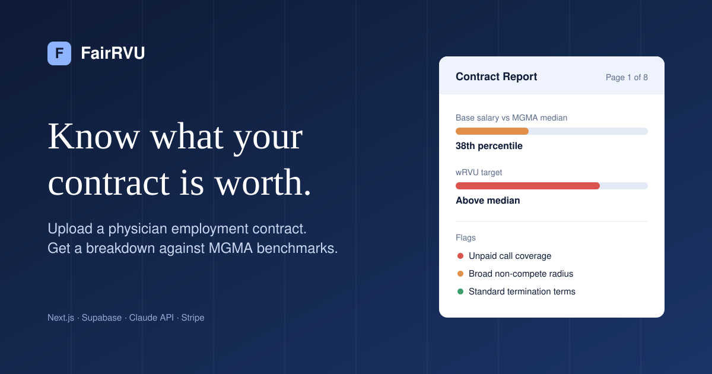
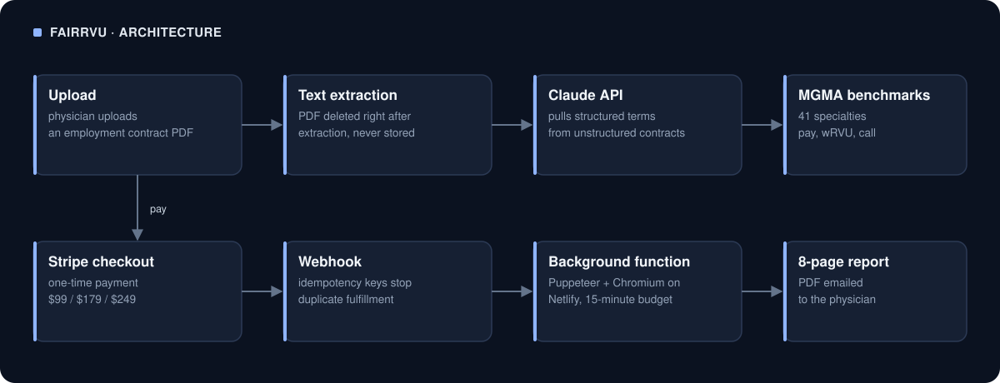

# FairRVU

**AI-powered physician contract analysis — built and shipped solo.**

**Status:** Earlier project, no longer live.

---

## What It Does

Physicians upload their employment contract (PDF). FairRVU extracts the contract terms, compares them against MGMA specialty benchmarks, and delivers an 8-page financial analysis report in under 60 seconds — flagging income gaps, above-median wRVU targets, uncompensated call burden, and non-compete risk.

One-time payment ($99 / $179 / $249). Contract deleted immediately after processing. No account required.

---

## Results

While live: **23 paying customers** and **60 contracts analyzed**, with no paid ads.

---

## Stack

| Layer | Technology |
|---|---|
| Frontend | Next.js 14 (App Router), TypeScript, Tailwind CSS v4 |
| Backend / API routes | Next.js API routes + Netlify background functions |
| AI analysis engine | Anthropic Claude API (claude-sonnet) |
| PDF report generation | Puppeteer + @sparticuz/chromium (serverless) |
| Database / Auth | Supabase (Postgres + Row Level Security) |
| Payments | Stripe (one-time checkout + webhook fulfillment) |
| Hosting | Netlify |
| Analytics | Google Analytics 4 (custom conversion events) |

---

## What I Built

Built entirely solo from zero to paying customers:

- **AI analysis pipeline** — prompt engineering against Anthropic Claude to extract structured financial data from unstructured contract PDFs and compare against MGMA benchmark data across 41 specialties
- **PDF report generation** — migrated from PDFKit to Puppeteer/Chromium for a pixel-accurate 8-page report rendered in a serverless environment with no native binary support
- **Stripe payment + fulfillment loop** — checkout session → webhook → background PDF generation → email delivery, with failure recovery
- **Supabase backend** — orders table, RLS policies, post-purchase Q&A chatbot authenticated via order lookup (no login wall)
- **SEO content system** — 31 specialty-specific pages auto-rendered from JSON, each with Article + FAQPage schema, dynamic branded OG images, and internal cross-linking
- **Free calculator** — wRVU income gap calculator with GA4 funnel tracking (calculator → upload → checkout → purchase)
- **GA4 conversion tracking** — 5 custom events wired across the full funnel

---

## Architecture

- PDF generation runs as a Netlify background function (async, 15-min timeout) to avoid serverless cold-start limits with Chromium
- Contract PDFs are deleted immediately after text extraction — never stored
- Stripe webhook fulfillment uses idempotency keys to prevent duplicate report delivery
- All 31 SEO pages are statically generated at build time from `/content/*.json`

---

*Physician contract analysis tool — not legal advice.*
